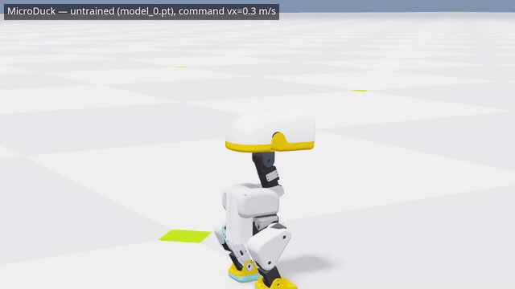
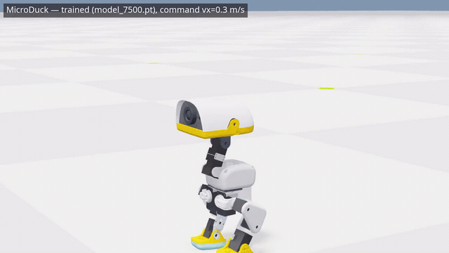

# MicroDuck velocity — training spec, driver and clips

A trained locomotion policy for the **Pollen Robotics MicroDuck** (14 Dynamixel XL330 servos) in
**Isaac Lab 3.0.0** on the Newton/Warp backend (no Isaac Sim), plus the script that drives it from the
keyboard and records 720p clips.

Task id: `IsaacContrib-Velocity-Flat-MicroDuck` — a contributed task that ships with Isaac Lab
(`source/isaaclab_tasks/isaaclab_tasks/contrib/microduck/`). Nothing in this repo changes the task; it
records and drives it.

(The ISAAC-TUTOR app that shares this directory keeps its documentation in [`TUTOR.md`](TUTOR.md).)

## Untrained vs trained

Untrained (`model_0.pt`), same command and camera — the duck topples, flails, resets:



[Watch the 720p MP4](media/duck_untrained_720p.mp4) — 300 steps, 1280×720, 50 fps, 6 s.

Trained (`model_7500.pt`, 7,638 iterations of PPO at 1024 envs) — steady stepping on the same command:



[Watch the 720p MP4](media/duck_trained_720p.mp4) — 500 steps, 1280×720, 50 fps, 10 s.

Both clips: one env, `base_velocity` command `vx = 0.3 m/s`, random pushes disabled, camera tracking the
trunk. Measured over 250 steps on the same command:

- untrained — trunk tilt swings 0°→55° (mid-fall), speed spikes to 0.45 m/s then resets, `z` dips to 0.094 m
- trained — trunk tilt 2–3°, speed 0.08–0.15 m/s against the 0.3 m/s command, `z` steady at 0.115–0.121 m

That 0.08–0.15 m/s against a 0.3 m/s command is the run's own `error_vel_xy 0.214 m/s` showing up: the policy
walks, it does not track accurately, and it has not learned to stand still (see §11 of the spec).

## Files

- `microduck_training_spec.md` — every number of the training run: timing, BAM servo model, command ranges,
  the 61-dim actor / 76-dim critic observation contract, 15 reward terms, terminations, domain
  randomisation, the curriculum schedule (ends at iteration 2000), PPO budget, achieved metrics, and how to
  reproduce.
- `duck_drive.py` — interactive keyboard driver for a checkpoint (I/U forward-back, J/L turn, K stop), with
  `--auto` for a scripted smoke test.
- `record_duck_video.py` — headless 720p recorder. Builds the env, loads a checkpoint, steps it with a fixed
  velocity command, tracks the trunk with the camera, writes an mp4 through Isaac Lab's `VideoRecorderCfg`.
- `media/` — the four clips above.

## Setup

Isaac Lab 3.0.0 with the Newton backend, plus the video extra:

```bash
git clone https://github.com/isaac-sim/IsaacLab.git   # v3.0.0
cd IsaacLab && uv sync --extra video                   # moviepy is what writes the mp4
```

These scripts live outside the clone and are run from inside it so `isaaclab` imports resolve.

## Train

```bash
cd ~/IsaacLab
uv run isaaclab train --rl_library rsl_rl --task IsaacContrib-Velocity-Flat-MicroDuck \
  --num_envs 1024 --logger tensorboard
# artifacts: logs/rsl_rl/microduck_velocity_flat/<timestamp>/
```

The PPO config asks for 50,000 iterations; the run behind these clips was stopped by hand at 7,638
(~41,400 steps/s, 0.60 s/iteration on an 8 GB RTX 3070 Laptop). Checkpoints land every 250 iterations.

## Drive

```bash
cd ~/IsaacLab
DISPLAY=:0 PYGLFW_LIBRARY_VARIANT=x11 uv run python ../duck_drive.py \
  --checkpoint logs/rsl_rl/microduck_velocity_flat/2026-10-27_14-41-49/model_7500.pt \
  --num_envs 2 --log_every 20
```

Click the Newton viewer window first (it behaves like any desktop app). `PYGLFW_LIBRARY_VARIANT=x11` is
required on a Wayland desktop, otherwise newton_gl dies with `undefined symbol: glfwGetX11Window`.

## Record a clip

```bash
cd ~/IsaacLab
uv run python ../record_duck_video.py --checkpoint <model.pt> \
  --out ../media --name duck_trained --steps 500 --forward_speed 0.3
```

Headless: `--width/--height` (default 1280×720), `--fps` (default 50, matching the 50 Hz policy rate),
`--eye/--lookat/--focal_length` for the camera, `--no_follow` to keep it fixed. Frames come from a headless
`newton_gl` visualizer, so no window and no display are needed.

## License

`duck_drive.py` and `record_duck_video.py` are BSD-3-Clause, matching Isaac Lab. The MicroDuck task,
robot asset and PPO config are Isaac Lab's own files and live upstream.
